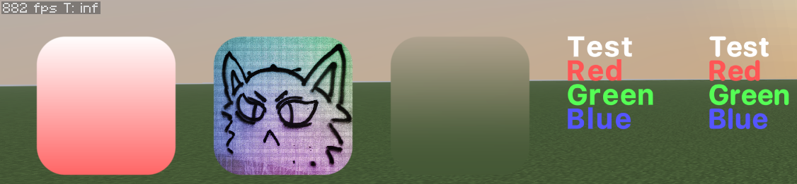

# Cicadas-Renderer

Рендер для всеми любимой игры Minecraft на версии 1.21.11 (может будут и другие)

## 2D
* Рект (закруглённый/обычный)
* Текстура (закруглённая/обычная)
* Блюр
* Сквиркл
* Жидкое стекло
* Текст

## 3D (AABB и VoxelShape)
* Боксы
* Оутлайны

## Анимации
* Simple
* Spring

## Функции плавности
* Simple
* CubicBezier

## Также рендер поддерживает загрузку SVG файлов в текстуру

## В тестовом моде есть [пример](src/testmod/kotlin/cicadas/mixtape/renderer/testmod/pass/HandsPass.kt) добавления кастомного шейдера на руки.

## Добавление библиотеки в проект

```kotlin
repositories {
    maven("https://jitpack.io")
}

dependencies {
    implementation("com.github.CicadasMixtape:cicadas-renderer:1.21.11-1.4.1")
}
```



Код превьюшки со скриншота находится [тут](src/testmod/kotlin/cicadas/mixtape/renderer/testmod/Testmod.kt).

###### (Написано полностью на котлине)